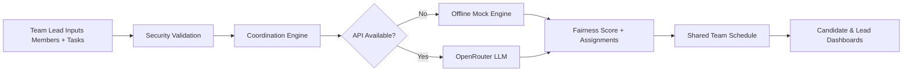

# TeamSync AI — Workload Coordinator

<div align="center">


<p>
  
  
  
  
  
  
</p>

An AI coordination engine that eliminates team burnout by turning chaotic tasks into mathematically balanced, conflict-free schedules.

</div>

## Why TeamSync AI?

Most teams do not fail because they lack effort — they fail because work is assigned without structure.

TeamSync AI transforms messy task lists, role overlap, and uneven capacity into a clear, fair, and explainable scheduling plan. It helps team leads assign work based on:

- real skill match
- available hours
- workload balance
- task criticality
- fairness and burnout prevention

Whether you're running a sprint, a hackathon, or a cross-functional project, TeamSync helps the team move from chaos to clarity.

---

## ✨ Core Features

- AI-assisted workload balancing using a deterministic mock engine and optional OpenRouter integration
- Team lead and candidate dashboards with personalized views
- Fairness scoring based on workload variance and capacity
- Human-readable assignment reasoning for every task
- Responsive HTML/CSS/JavaScript frontend
- Secure input sanitization, XSS protection, and structured auth flows
- Offline-safe mock mode for demos and local testing

---

## 🧠 How It Works



The coordination engine evaluates:

- member skill alignment
- current workload load
- available hours headroom
- task importance and required domain expertise

Then it produces:

- a fairness score from 0–100
- a concise executive summary
- a per-task assignment with reasoning

---

## 🚀 Quick Start

### 1) Clone the repository

```bash
git clone https://github.com/muhammadhurres/TeamSync-AI-Workload-Coordinator.git
cd TeamSync-AI-Workload-Coordinator
```

### 2) Create a virtual environment

```bash
python -m venv .venv
source .venv/bin/activate   # Windows: .venv\Scripts\activate
```

### 3) Install dependencies

```bash
pip install -r requirements.txt
```

### 4) Configure environment

```bash
cp .env.example .env
```

Edit `.env` and optionally set:

```dotenv
OPENROUTER_API_KEY=
MOCK_MODE=False
HOST=127.0.0.1
PORT=8000
```

### 5) Run the app

```bash
python app.py
```

Then open:

- http://127.0.0.1:8000/
- http://127.0.0.1:8000/judge

---

## 🏗️ Project Structure

```text
TeamSync-AI-Workload-Coordinator/
├── api/
│   └── index.py
├── static/
│   ├── app.js
│   ├── index.html
│   ├── judge.html
│   └── style.css
├── .env.example
├── app.py
├── coordinator.py
├── security.py
├── storage.py
├── requirements.txt
├── vercel.json
├── README.md
├── teamsync ai thumbnail.png
└── LICENSE
```

---

## 🔐 Security & Reliability

TeamSync includes built-in protections to keep the app stable and safe for demos and local usage:

- sanitization of names, skills, and task text before storage or processing
- prompt-injection marker stripping
- HTML escaping to reduce XSS attack surface
- input bounds validation using Pydantic models
- graceful fallback to mock mode when the API is unavailable or not configured

This makes the app resilient in demo environments, hackathons, and early-stage deployments.

---

## 📡 API Overview

### Health Check

```http
GET /api/health
```

Returns whether the app is running and whether it is in mock mode or live API mode.

### Authentication

```http
POST /api/auth/register
POST /api/auth/login
GET /api/user/{username}/dashboard
POST /api/user/{username}/dashboard
```

### Coordination

```http
POST /api/coordinate
```

Body example:

```json
{
  "members": [
    {"name": "Ava", "skills": "Frontend, UX", "hours": 18},
    {"name": "Leo", "skills": "Python, Backend", "hours": 20},
    {"name": "Maya", "skills": "Data, ML", "hours": 16}
  ],
  "tasks": [
    {"title": "Build dashboard", "required_skill": "Frontend", "estimated_hours": 6},
    {"title": "Create API endpoints", "required_skill": "Backend", "estimated_hours": 8},
    {"title": "Train recommendation model", "required_skill": "ML", "estimated_hours": 10}
  ]
}
```

Returns:

- `fairness_score`
- `executive_summary`
- `assignments`
- `is_mock`

---

## 🧪 Demo Experience

The app is designed for quick, tangible demo value:

1. Add team members with skills and available hours
2. Add tasks with required skills and workloads
3. Generate a coordinated schedule
4. Inspect fairness and assignment reasoning
5. See balanced output instantly on the dashboard

This makes it effective for pitching, prototyping, and rapid planning exercises.

---

## 🧩 Tech Stack

- Python
- FastAPI
- Pydantic
- JavaScript
- HTML + CSS
- OpenRouter API (optional live coordination)
- Offline mock coordination engine

---

## 🛣️ Roadmap

- richer scheduling constraints (dependencies, deadlines, role conflicts)
- calendar-style view for weekly coordination
- export to CSV/PDF/JSON
- multi-team / multi-project orchestration
- analytics dashboard for burnout and workload trends
- better UX polish and dashboard animations

---

## 📜 License

This project is licensed under the MIT License.

---

## 🙌 Built For

- startup teams
- engineering squads
- hackathon organizers
- product and operations teams
- anyone trying to reduce scheduling chaos and burnout

If you want to make planning feel less like guessing and more like engineering, TeamSync AI is built for that.

---

<p align="center">
  <b>TeamSync AI</b> — turning distributed chaos into balanced execution.
</p>


## Deploy to Vercel

Import the repository into Vercel and deploy from the repository root. The
serverless entry point is `api/index.py`; `vercel.json` routes requests to it
and includes the root-level HTML, CSS, and JavaScript files required by the app.
## Deploy to Vercel

Import the repository into Vercel and deploy from the repository root. The
serverless entry point is `api/index.py`; `vercel.json` routes requests to it
and includes the root-level HTML, CSS, and JavaScript files required by the app.
